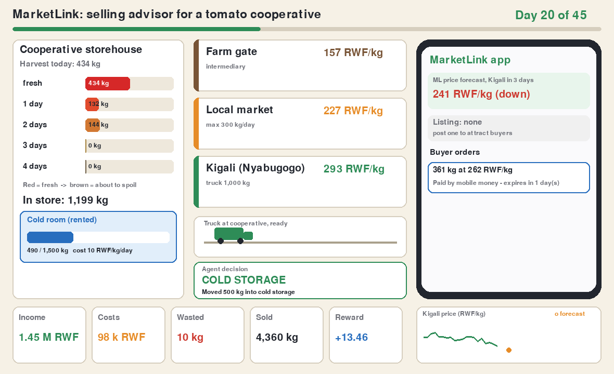

# Larissa Iriza – RL Summative: MarketLink selling advisor for a rural tomato cooperative

**Mission:** smallholder farmers in rural Rwanda receive low prices because intermediaries control market information. My mission is a market-linkage platform with ML price prediction, product listing, ordering and mobile-money payments. In this project an RL agent acts as the platform's **selling advisor**: every day of a 45-day harvest season it decides where, when and how much a tomato cooperative should sell, so that the cooperative earns more and wastes less than when it sells everything at the farm gate.



## Quick start (marker)

Requires [uv](https://docs.astral.sh/uv/). Runs on CPU (Windows, macOS, Linux).

```bash
git clone https://github.com/Larissa4-droid/larissa_iriza_rl_summative.git
cd larissa_iriza_rl_summative
uv sync
uv run main.py
```

`uv run main.py` opens the pygame window and runs the best trained agent for one unseen season, printing every day's decision in the terminal. Trained models and logs are included, so no training is needed.

More options:

```bash
uv run main.py --algo dqn               
uv run main.py --scenario price_glut    
uv run main.py --random                 
uv run main.py --no-render             
uv run pytest                         
```

## Environment summary (`environment/custom_env.py`)

| Item | Design |
|---|---|
| Agent | Selling advisor for one tomato cooperative on the MarketLink platform |
| Episode | One 45-day harvest season, one step = one day |
| Actions (Discrete 9) | `HOLD`, `INTERMEDIARY 25%`, `INTERMEDIARY 50%`, `LOCAL MARKET 25%`, `LOCAL MARKET 50%`, `TRUCK TO KIGALI`, `ACCEPT ORDER`, `COLD STORAGE`, `POST LISTING` |
| Observation (Box 17, float32, 0–3) | stock by age (5), cold stock, harvest today, farm-gate / local / Kigali price, ML 3-day Kigali price forecast, best buyer order (qty, price), number of orders, listing days left, truck available, day of season |
| Reward | (sales income − transport − cold storage − listing fee − value of spoiled tomatoes) / 100,000 RWF, −0.02 for an impossible action, −5 if the season fails |
| Start | Day 1, 0–300 kg of stock, a newly generated price path and harvest curve |
| Terminal | Day 45 (leftover stock sold at the farm gate), or more than 30 % of the harvest wasted after day 10 (season failed) |

All numbers are simulation assumptions documented at the top of `custom_env.py`.

## Training (TorchRL)

```bash
uv run python -m training.dqn_training               
uv run python -m training.pg_training --algo all     
uv run python -m training.analysis                  
```

Single run: `--run 3`. Different budget: `--frames 40000` (default 80,000 environment steps per run, the same for all four methods).

`training.analysis` writes the figures to `assets/` and the sweep tables, convergence, generalisation and behaviour tables to `logs/`, plus `logs/best_models.json`, which `main.py` uses to load the best agent.

## Project structure

```
main.py / play.py   run the best trained agent with the visualisation
environment/        custom_env.py (Gymnasium environment), rendering.py (pygame visualisation)
training/           common.py, dqn_training.py, pg_training.py (TorchRL), analysis.py
models/             saved models: dqn/ and pg/
logs/               training curves (JSON), sweep tables and summaries (CSV)
assets/             screenshot and report figures
tests/              environment tests
```
